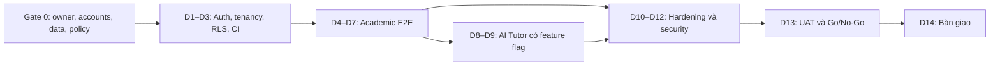

# Phân tích và tiến trình thực thi Sprint 0 — Hệ thống Trường học AI

> Nguồn phân tích: `C:\Users\Haydern\Downloads\ke-hoach-he-thong-truong-hoc-ai-quy-mo-lon-14-ngay.md`
> Ngày lập tiến trình: 28/07/2026
> Cách tiếp cận: `ponytail full` — giữ lát cắt nhỏ nhất chứng minh được giá trị, không cắt tenant isolation, security, privacy hoặc accessibility trên critical flow.
> Trạng thái workspace: repository local đã được khởi tạo; các đường dẫn bên dưới hiện là cấu trúc triển khai thực tế.

## Trạng thái thực thi cập nhật — 29/07/2026

- **Ngày 1–3:** hoàn tất local foundation gồm monorepo, Auth/session, hai tenant synthetic, ba role, RLS, CI, web shell và Expo shell.
- **Ngày 4–7:** hoàn tất local Academic Alpha gồm Admin tạo lớp/gán identity seed, Teacher công bố bài/xem bài nộp/phản hồi, Student Expo xem bài/nộp text/xem trạng thái-phản hồi.
- **Ngày 6:** hoàn tất Community Safety text-only có Moderator riêng, membership controls, report/hide/escalate/resolve và tenant-safe realtime.
- **Ngày 7 — AI Tutor có điều kiện:** hoàn tất gateway server-only, consent/version, quota DB, usage metadata không chứa prompt/answer, PostgreSQL lexical FTS, citation allowlist/abstain, timeout/provider failure, web Student panel và Expo Student stack route. Runtime vẫn **OFF theo mặc định**.
- **Ngày 9 — AI eval/citation hardening:** hoàn tất bộ eval tự động cố định 24 case, citation mở được nhưng vẫn fail-closed, Cancel/Retry trên web/mobile và regression AI-off bằng production server riêng.
- **Ngày 10 — feature freeze:** inventory guard khóa tám tên migration, 17 web BFF route, hai web page entry point, bốn web runtime-library file, hai functional web UI component, 11 Expo route, bốn workspace package và direct dependency inventory; mobile API dùng chung ánh xạ lỗi mất mạng ổn định để retry nhưng vẫn giữ nguyên `AbortError` cho Cancel.
- **Ngày 8–12:** local hardening gồm quota tại DB mutation boundary, config/accessibility/security checks, migration `002 → current`, backup/restore, runbook release và feature-freeze guard; các gate thiết bị, staging và phê duyệt vẫn ở bên ngoài workspace.
- **Implementation evidence Ngày 10 + CI hardening Ngày 11–12:** `verify:static` đạt; configuration/freeze đạt 5/5; mobile API client đạt 4/4; reset Supabase có fallback debug và barrier Auth fail-closed với cửa sổ readiness 60 giây; baseline application/config/test đã được validate là `973e1048952638692a265191edc2a0ab0f1dc914`.
- **Full regression cùng SHA:** migration reset sạch; 298/298 pgTAP gồm cả hai nhánh quota qua ngày UTC và schema lint sạch; Next production build có 17 BFF route (4 academic, 10 community, 3 AI); eval đạt 24/24 (TAP 25 gồm parent); ba production API integration suite đạt 1/1; Chrome E2E đạt 16/16; production server AI-off đạt academic 1/1 + AI-off 1/1. Hosted [CI run 30410225676](https://github.com/HaydernCenterpoint/sao-do-school-ai/actions/runs/30410225676) đạt `quality` trong 1m35s; job `database` đạt hai lần liên tiếp trên cùng SHA trong [8m42s](https://github.com/HaydernCenterpoint/sao-do-school-ai/actions/runs/30410225676/job/90444435491) và [8m29s](https://github.com/HaydernCenterpoint/sao-do-school-ai/actions/runs/30410225676/job/90445891577).
- **Gate chưa đạt bên ngoài workspace:** gateway limit/monitoring trên staging cho GET, invalid JWT và attempt bị chặn trước DB mutation; human semantic-grounding reviewer cho 8/8 answerable case; nhà cung cấp/key AI được phê duyệt và privacy/safeguarding approval; staging/production deploy; EAS Preview cài được; Android physical-device/TalkBack smoke; UAT và sign-off. Mọi SHA được promote sau này vẫn phải chạy lại hosted CI và smoke trên đúng deployment target.
- Vì các gate ngoài workspace chưa đạt, nhãn hiện tại là **Academic Alpha + text-only Community Safety + bounded AI Tutor / Day 10 local candidate**, chưa phải school pilot hoặc release candidate bên ngoài.
- Runbook, known issues và slot sign-off: `docs/release-candidate.md`.

## 1. Kết luận điều hành

Tài liệu gốc là một **blueprint dài hạn tốt**, nhưng chưa phải một kế hoạch Sprint 0 có thể giao an toàn trong 14 ngày.

Điểm đúng:

- Tài liệu tự xác định 14 ngày chỉ nên là Sprint 0 + vertical slice, không phải hệ thống hoàn chỉnh (`dòng 24–30`).
- Các nguyên tắc multi-tenant, server-only secrets, privacy và human-in-the-loop được đặt đúng (`dòng 65–76`).
- Modular monolith với Next.js, Expo và Supabase là hướng phù hợp để khởi động nhanh (`dòng 125–193`).
- RLS, hai tenant kiểm thử, ownership và Definition of Done được mô tả khá tốt (`dòng 195–224`, `499–519`, `823–906`).

Điểm chưa khả thi:

- Sprint 0 vẫn chứa 29 page template và 12 luồng độc lập (`dòng 650–751`), gồm academic, realtime community, moderation, RAG, AI memory, camera OCR, sinh ảnh, hồ sơ, việc làm/nhà trọ và notification.
- Lịch 14 ngày dành gần như mỗi ngày cho một sản phẩm con mới, rồi dồn security/QA vào ngày 12 (`dòng 766–783`).
- Ngày 1 ghi khóa “10 flow”, nhưng phần nghiệm thu định nghĩa 12 flow (`dòng 770`, `693–741`).
- Flow onboard cần Platform Admin, nhưng UI Platform Admin được xếp từ P1 (`dòng 542–552`, `695–697`).
- Flow Profile yêu cầu employer xem hồ sơ công khai, trong khi UI employer/landlord chỉ có từ P2 (`dòng 641–648`, `723–725`).
- Camera TTL và listing expiry cần runtime theo lịch, nhưng cơ chế publisher/queue lại được hoãn sang Phase 1 (`dòng 711–721`, `927–948`).
- “Bốn vai trò” của Sprint 0 không khớp ma trận phân quyền năm vai trò (`dòng 83`, `501–510`).
- Các điều kiện quyết định phạm vi pháp lý và vận hành vẫn nằm ở danh sách chuẩn bị, chưa thành Gate 0 bắt buộc (`dòng 1146–1159`).

### Quyết định đề xuất

Ngày 14 chỉ cam kết một **academic technical pilot đa tenant**:

> School Admin tạo lớp và gán Teacher/Student → Teacher tạo bài tập → Student xem và nộp bài trên Android → Teacher phản hồi → Student xem trạng thái/phản hồi.

AI Tutor là nhánh P0 có điều kiện:

> Student hỏi trên một bộ tài liệu mẫu đã nạp sẵn → hệ thống chỉ truy xuất đúng tenant → trả lời có citation hoặc từ chối → AI lỗi/tắt không ảnh hưởng luồng học thuật.

Nếu giữ nguyên toàn bộ phạm vi gốc, nên đổi mốc Sprint 0 thành ít nhất 6–8 tuần. Nếu giữ mốc 14 ngày, phải dùng cut-line trong tài liệu này.

## 2. Tóm tắt yêu cầu thực thi

### Kết quả phải đạt

- Một web portal tối giản cho School Admin, Teacher và Moderator của extension Community Safety.
- Một Expo/Android app tối giản cho Student.
- Hai tenant demo, ba vai trò học thuật `admin`, `teacher`, `student` và vai trò `moderator` chỉ cho extension Community Safety.
- Luồng học thuật Admin → Teacher → Student chạy xuyên suốt.
- RLS/RBAC và server authorization chặn mọi truy cập sai tenant hoặc sai vai trò.
- AI Tutor có citation là tính năng có feature flag, không phải điều kiện để core academics hoạt động.
- Có CI, test evidence, UAT, Android preview, runbook và known-issues list.

### Không phải mục tiêu Sprint 0

- Không chứng minh quy mô 1.000 trường, 1 triệu người dùng hoặc SLO production.
- Không public App Store/Google Play.
- Không hoàn thiện “student super-app”.
- Không xử lý dữ liệu học sinh thật hoặc người dưới 18 tuổi nếu chưa có phê duyệt privacy/safeguarding phù hợp.
- Không xây abstraction cho dedicated cluster, event bus, warehouse hoặc microservices tương lai.

## 3. Cut-line phạm vi

### P0 bắt buộc

| Nhóm | Phạm vi |
|---|---|
| Identity/Tenancy | Auth, tenant/school context, membership-scoped role, hai tenant seed |
| Security | RLS trên 100% bảng nghiệp vụ, server-side authorization, log redaction, secret scan |
| Admin Web | Đăng nhập; tạo/xem lớp; gán Teacher/Student từ các identity đã seed |
| Teacher Web | Xem lớp; tạo bài tập; xem bài nộp; phản hồi |
| Student Mobile | Đăng nhập; xem lớp/bài tập; nộp bài dạng text; xem trạng thái/phản hồi |
| Data | Migration append-only, seed tái lập được, audit cho thay đổi role/class/assignment/submission |
| Quality | Loading, empty, error, retry, permission-denied; WCAG/TalkBack checklist trên critical flow; web E2E và Android device smoke |
| Operations | Staging, production candidate, backup/restore smoke, deploy/rollback/provider-outage runbook |

### P0 có điều kiện: AI Tutor mỏng

- Một provider và một model cấu hình phía server.
- Tài liệu mẫu được nạp bằng seed/import script; không xây UI ingest trong Sprint 0.
- Dùng Postgres full-text retrieval trước; chỉ thêm `pgvector` nếu bộ eval chứng minh full-text không đủ.
- Citation phải mở được đúng tài liệu/chunk thuộc tenant hiện tại.
- Có consent, quota, timeout, usage metadata và feature flag.
- Không tool ghi dữ liệu, không persistent memory, không teacher view, không model registry UI.
- Không lưu prompt/chat mặc định; chỉ lưu metadata vận hành không chứa nội dung riêng tư.
- Không provider fallback; khi provider lỗi, trả graceful error.

### P0 extension đã khóa: Community Safety text-only

Cut-line được sửa đổi và khóa ở Ngày 6 để giữ phần Community Safety text-only đã triển khai và đang hiển thị: space theo lớp, message/reaction, report, block/mute/leave, slow mode và Moderator xử lý report trong đúng tenant. Extension này phải đi qua RLS/integration/E2E và UAT Moderator/Safeguarding riêng; nó không làm rộng critical path Academic Alpha. Media upload, direct message, public discovery và moderation tự động vẫn ngoài Sprint 0.

### Hoãn sang Phase 1+

| Hạng mục | Lý do hoãn |
|---|---|
| User invitation/provisioning UI | Pilot dùng identity fixture/seed; tránh service-role trên request path |
| File submission và user-uploaded knowledge | Cần quarantine, allowlist, malware scan và signed-download policy; text-only đủ chứng minh academic flow |
| Community ngoài extension text-only đã khóa: media, direct message, public discovery, moderation tự động | Cần media safety pipeline, chính sách bổ sung và device/UAT riêng |
| Camera OCR/translate và image generation | Phát sinh media pipeline, TTL worker, moderation và device QA |
| AI memory, study planner, support signals | Privacy và evidence model chưa cần để chứng minh core flow |
| Profile/CV, jobs/housing/listings | Không nằm trên critical path học thuật |
| Attendance, gradebook, rubric, timetable | Mở rộng domain academic trước khi core flow ổn định |
| Push notification | Student có thể thấy bài mới trực tiếp trong Home/Class; chưa cần notification service |
| Public CMS/news, custom domain | Một landing tĩnh là đủ cho closed beta |
| Platform Admin/Employer/Parent UI | Không cần cho pilot; Moderator chỉ tồn tại trong extension Community Safety đã khóa |
| CSV import UI | Dùng seed/import script có validation |
| PostGIS, Redis, outbox publisher, event bus, analytics | Chưa có consumer/tải thực tế để biện minh |
| Dedicated-cluster data routing abstraction | Thêm khi có tenant thực sự cần tách data plane |

## 4. Gate 0 — điều kiện trước khi tính Ngày 1

Sprint chỉ bắt đầu khi tất cả mục dưới đây có owner và trạng thái đạt:

- [ ] Xác nhận “14 ngày” là 14 ngày làm việc.
- [ ] Chỉ định một Human Product/Tech Lead có quyền scope freeze, merge, deploy và business Go/No-Go.
- [ ] Chỉ định một QA/Security Reviewer độc lập với ba coding lane; reviewer này đồng ký security gate và sở hữu severity classification.
- [ ] Chỉ định ít nhất một School Admin/Teacher làm UAT từ ngày 4.
- [ ] Chốt pilot là đại học/cao đẳng hay có người dưới 18 tuổi, cùng quốc gia áp dụng.
- [ ] Chọn đúng một chế độ:
  - **Sandbox allowlisted** — toàn bộ identity/data là synthetic; đây là mặc định khuyến nghị.
  - **Real-user pilot** — có privacy/safeguarding approval artifact, named approver và retention/incident owner.
- [ ] Có retention/consent policy tạm thời bằng văn bản.
- [ ] Có GitHub, Supabase, Vercel, Expo/EAS, Android package ID và staging domain.
- [ ] Có fixture manifest cho tenant A/B, ba synthetic identity mỗi tenant và class/assignment seed cần tạo từ D2.
- [ ] Có ít nhất một thiết bị Android thật để smoke test.
- [ ] Chốt AI Tutor là feature có thể tắt; nếu business bắt buộc AI thì ghi rõ AI là release blocker.
- [ ] Nếu AI bật: có model API key, 10–20 tài liệu synthetic/de-identified và owner phê duyệt eval set.
- [ ] Severity rubric trong mục 13 đã được Human Lead và QA/Security Reviewer ký trước D1.

Nếu chưa đạt Gate 0, kết quả chỉ được gọi là **sandbox prototype**, không gọi là school pilot.

## 5. Kiến trúc Sprint 0 tối thiểu

### Cấu trúc dự kiến

```text
apps/
├── web/                 Next.js: Auth + Admin + Teacher + BFF
└── mobile/              Expo: Student thin client
packages/
├── types/
├── validation/
├── api-client/
└── ai/                  Chỉ khi nhánh AI được bật
supabase/
├── migrations/
├── seed/
└── tests/
docs/
├── adr/
├── privacy/
└── runbooks/
```

### Quy tắc truy cập

- Client chỉ dùng Supabase trực tiếp cho sign-in/sign-out/session refresh.
- Mọi nghiệp vụ class/assignment/submission/feedback đi qua BFF/server route dùng chung cho web và mobile.
- Server không tin `tenant_id` do client gửi; mỗi request phải đối chiếu tenant đang chọn với membership hiện hành.
- Mọi request path truy vấn Supabase bằng JWT của người dùng để RLS được thực thi; **cấm service-role trên request path**.
- Service-role chỉ được phép trong migration, seed và offline AI-document import do Lane A chạy; không tồn tại trong web/mobile bundle hoặc runtime route.
- P0 chỉ nộp bài dạng text. User file upload, quarantine, malware scan và signed-download URL được hoãn sang Phase 1.
- AI Gateway chỉ chạy phía server và chỉ nhận dữ liệu đã được authorize.
- Không dùng Realtime trong Sprint 0.
- Không tạo generic data-routing layer cho dedicated cluster; chỉ tạo một helper tenant context nhỏ và dùng nhất quán.
- Không tạo bảng role/permission động; dùng ba role cố định trong membership, mở rộng ở Phase 1 khi có nhu cầu thật.

## 6. Workstream và ownership

| Lane | Ownership | Đường dẫn dự kiến |
|---|---|---|
| A — Platform/Data/Security | Migrations, seed, RLS, auth/tenant helper, API contract, server routes, audit, AI server sau ngày 7 | `supabase/**`, `packages/types/**`, `packages/validation/**`, `packages/api-client/**`, `packages/ai/**`, `apps/web/app/api/**` |
| B — Web Admin/Teacher | Admin/Teacher UI, states, accessibility, web E2E evidence | `apps/web/**` ngoài server-owned paths |
| C — Student Mobile | Expo app, auth session, class/assignment/submission/feedback, AI client sau ngày 7, Android build | `apps/mobile/**` |
| QA/Security Reviewer | RLS negative tests, ID tampering, secret/bundle scan, E2E, AI eval, severity classification và regression | Read/review toàn repo; độc lập với ba coding lane; đồng ký D12/D13 |
| Human Lead | Contract, merge, UAT, deploy và business Go/No-Go | Không tự hạ severity hoặc waive No-Go; security gate cần reviewer đồng ký |

Backend/migration chỉ có một owner. Shared types chỉ đổi qua Lead review. AI không tạo lane thứ tư: sau academic alpha, Lane A và C lần lượt chuyển sang AI server/client.

## 7. Critical path



Critical path tuyệt đối:

```text
Gate 0
→ migration/Auth/RLS/two-tenant seed
→ class/membership
→ assignment
→ validated text submission
→ teacher feedback
→ web/mobile E2E
→ security regression
→ UAT
→ release
```

## 8. Tiến trình 14 ngày

| Ngày | Lane A — Platform/Data/Security | Lane B — Web | Lane C — Mobile | Gate cuối ngày |
|---:|---|---|---|---|
| 1 | Khóa ERD tối thiểu, RBAC/RLS matrix, API contract, retention/consent, threat boundaries | Wireflow Admin/Teacher, tối đa 4 màn hình nghiệp vụ | Wireflow Student, tối đa 4 màn hình core + 1 AI conditional | **Scope freeze**; một academic flow; mọi story có acceptance |
| 2 | Tạo monorepo, CI, staging config, migration v1, seed A/B, Auth/TenantContext | Web shell + login/session | Expo shell + login/session | CI chạy lint/typecheck/build/migration/secret check; không secret trong repo |
| 3 | Membership, class schema/API, RLS positive/negative tests | Admin People & Classes shell tích hợp thật | Tenant-aware Home/Class shell; baseline EAS build xác minh credentials/native setup | **Foundation gate**: ba role login; A không đọc/ghi B; schema/API freeze; build baseline cài được |
| 4 | Class/membership API hoàn chỉnh; audit role/class changes | Admin tạo lớp và gán Teacher/Student đã seed | Student thấy đúng lớp của mình | Micro-UAT đầu tiên; dữ liệu đúng tenant và đúng role |
| 5 | Assignment API; trạng thái publish/due date | Teacher tạo/xem bài tập | Assignment list/detail | Teacher tạo bài; đúng student thấy bài; user ngoài lớp bị chặn |
| 6 | Text submission API, validation, length limit và idempotency | Teacher xem danh sách submission | Student nộp text; retry/error | Retry không tạo duplicate; ID tampering bị chặn |
| 7 | Feedback/status API; audit; full academic regression | Teacher phản hồi | Student xem trạng thái/phản hồi; EAS academic-alpha build | **Academic alpha** chạy E2E trên staging và Android |
| 8 | Nếu D7 đạt và Gate 0 bật AI: seed/import tài liệu, full-text chunks, access scope, AI Gateway server-only; nếu không, bắt đầu hardening | Hiển thị trạng thái AI/feature flag tối thiểu nếu AI bật | AI Tutor shell nếu AI bật | Chỉ tài liệu authorized của tenant hiện tại được retrieval; AI-off không chặn ngày |
| 9 | Nếu AI bật: consent, quota, timeout, usage metadata, citation/abstain và eval; nếu không, tiếp tục security/resilience | Không mở scope web mới | Tutor citation/retry/provider unavailable hoặc tiếp tục core QA | **AI gate**: đúng scope hoặc feature flag OFF |
| 10 | Sửa integration; khóa migration/schema; rate limit/log redaction | Hoàn thiện loading/empty/error/permission states | Hoàn thiện states và offline/error cơ bản | **Feature freeze**; không thêm màn hình/provider/dependency |
| 11 | Backup/restore smoke; migration replay; provider-outage test | WCAG 2.2 AA checklist trên critical flow; web E2E | Android physical-device smoke; TalkBack/text-scaling checklist | Release Candidate 1; không còn mock trong core flow |
| 12 | Full RLS/security/secret/AI regression | Chỉ sửa P0/P1 liên quan release | Chỉ sửa P0/P1; tạo EAS RC Preview | **Code freeze**; 0 Critical/High; QA/Security đồng ký; build cài được |
| 13 | Deploy production candidate, seed pilot, rollback rehearsal | UAT School Admin/Teacher | UAT Student và AI nếu bật | UAT sign-off; Go/No-Go; blocker có owner |
| 14 | Chỉ sửa P0 nếu đủ thời gian tái chứng nhận; smoke production; hoàn thiện report/runbook | Hướng dẫn Admin/Teacher; rerun affected E2E nếu có sửa | Android final preview hoặc rebuild nếu mobile đổi | Bàn giao chỉ khi evidence bị ảnh hưởng đã chạy lại và QA/Security đồng ký |

## 9. Recovery checkpoint

| Checkpoint | Điều kiện đạt | Nếu không đạt |
|---|---|---|
| Cuối D3 | Auth, CI, seed A/B và RLS negative tests xanh | Dừng feature; sửa foundation. Nếu không phục hồi trong D4, hạ nhãn xuống technical prototype |
| Cuối D7 | Academic flow chạy E2E web + Android | Bỏ toàn bộ AI khỏi Sprint 0; D8–D10 dùng để hoàn tất core |
| Cuối D9 | AI không leak scope, citation hợp lệ, timeout graceful | Tắt feature flag; không nới quyền để “cho chạy” |
| Cuối D10 | Feature freeze; core flow không mock | Mọi hạng mục chưa hoàn tất chuyển backlog |
| Cuối D12 | 0 Critical/High; migration replay/build đạt; QA/Security đồng ký | No-Go; không phát hành pilot |
| Cuối D13 | UAT sign-off và rollback sẵn sàng | No-Go hoặc sandbox demo có ghi rõ giới hạn |

Mọi thay đổi code, config hoặc migration sau D12 làm mất hiệu lực evidence liên quan. Trước bàn giao phải chạy lại targeted regression, toàn bộ critical academic E2E, EAS build nếu mobile bị ảnh hưởng, UAT subset tương ứng và QA/Security re-sign. Không đủ thời gian tái chứng nhận thì No-Go hoặc chỉ bàn giao sandbox.

## 10. Nhịp vận hành mỗi ngày

1. **08:00–08:20** — Lead chốt outcome, acceptance, dependency và blocker.
2. **08:20–08:30** — Contract check giữa ba lane.
3. **08:30–11:45** — Thực thi theo ownership.
4. **11:45–12:00** — Self-test và handoff evidence.
5. **12:00–13:00** — Merge batch 1; chạy CI.
6. **13:00–13:20** — QA/Security kiểm tra thay đổi rủi ro cao.
7. **13:30–16:45** — Fix integration và hoàn tất gate.
8. **17:00–17:45** — Merge batch 2; deploy staging.
9. **18:00–18:45** — Regression và micro-UAT từ ngày 4.
10. **18:45–19:00** — Lead ghi pass/fail, blocker owner và cut-line ngày kế tiếp.

Quy tắc:

- P0 dừng công việc feature của lane liên quan.
- Trượt critical path một ngày: bỏ polish hoặc AI, không giảm RLS/security tests.
- Sau ngày 10 chỉ sửa lỗi.
- Không task nào “Done” nếu thiếu acceptance evidence.

## 11. Acceptance criteria

### Tenant và role

- [ ] Hai tenant A/B, mỗi tenant có Admin/Teacher/Student.
- [ ] 100% bảng nghiệp vụ bật RLS.
- [ ] 100% bộ test cross-tenant read/write/ID tampering trả `403`, zero rows hoặc lỗi tương đương mà không lộ dữ liệu.
- [ ] Student chỉ xem/nộp bài của chính mình trong lớp đã ghi danh.
- [ ] Teacher chỉ xem lớp mình phụ trách.
- [ ] School Admin chỉ quản trị membership trong tenant của mình.

### Academic E2E

- [ ] Từ seed sạch: Admin tạo lớp → gán Teacher/Student → Teacher tạo bài → Student Android xem/nộp → Teacher phản hồi → Student xem kết quả.
- [ ] Nộp lại cùng idempotency key không tạo duplicate submission.
- [ ] Submission chỉ nhận text đã validate; giới hạn mặc định 20.000 ký tự; file/URL payload bị từ chối.
- [ ] Core flow có loading, empty, error, retry và permission-denied state.

### Community Safety text-only

- [x] User sai tenant hoặc cùng tenant nhưng không phải member của space không thể đọc, đăng hoặc sửa Community content.
- [x] Contact/link/OTP/address/identity-like text yêu cầu privacy confirmation; report và moderation audit không chứa message, report detail hoặc moderator note.
- [x] Report retry không tạo duplicate; Moderator chỉ xem queue đúng tenant; hide/resolve/escalate/dismiss có transition và audit; hidden content rời member view.
- [ ] Realtime subscription trên staging chỉ nhận event của space/tenant được phép và không nhận event cross-tenant.
- [ ] Moderator/Safeguarding representative hoàn tất UAT report → queue → action → member-view result.

Nếu một tiêu chí Community chưa đạt, candidate có extension này là **NO-GO**. Chỉ được promote Academic Alpha không Community sau khi extension được gỡ hoặc tắt an toàn và toàn bộ route inventory, build, integration, E2E, accessibility, UAT subset và release evidence bị ảnh hưởng đã chạy lại.

### Secrets và audit

- [x] Không có service-role/model key trong repository, web bundle, mobile bundle hoặc log.
- [x] Thay đổi membership, assignment, submission và feedback có audit record gồm actor, tenant, action và timestamp.
- [x] Log AI chỉ chứa tenant/user/capability/model/latency/usage/status; không chứa secret, prompt, answer hoặc source content.

### AI Tutor — chỉ khi feature bật

- [x] Bộ eval có đúng 24 case: 8 answerable (4/tenant), 4 thiếu nguồn, 4 cross-tenant/ID tampering, 4 prompt injection và 4 timeout/provider error.
- [x] 24/24 case không trả citation hoặc retrieved chunk ngoài tenant/access scope.
- [ ] 8/8 answerable case có citation mở được và reviewer xác nhận câu trả lời được nguồn hỗ trợ.
- [x] 4/4 case thiếu nguồn từ chối, không bịa citation.
- [x] 8/8 cross-tenant/prompt-injection case không vượt scope hoặc tiết lộ dữ liệu.
- [x] 4/4 timeout/provider-error case trả Retry/Cancel và không làm treo app.
- [x] Tắt AI feature flag không ảnh hưởng auth, class, assignment, submission hoặc feedback.

Automated local coverage đạt đúng bộ 24 case cố định và xác nhận 8/8 answerable có citation mở được. Ô kết hợp 8/8 phía trên vẫn để mở vì **human semantic-grounding reviewer còn PENDING 8/8**; automation không phải phê duyệt của con người. Báo cáo: [Day 9 AI evaluation](../../docs/day-9-ai-evaluation.md).

### Release

- [x] Migration + seed chạy lại từ môi trường sạch.
- [x] Backup/restore smoke thành công.
- [x] Web production candidate chạy core flow.
- [ ] Android EAS Preview cài và chạy core flow trên ít nhất một thiết bị thật.
- [ ] Tất cả critical web screens đạt checklist WCAG 2.2 AA: keyboard-only, logical focus order, không focus trap, visible focus, accessible name/error, contrast 4.5:1 cho text thường và text scaling 200% không mất critical action.
- [ ] Tất cả critical Android screens có TalkBack name/role/state, logical swipe order và text scaling 200% không che critical action.
- [ ] Không còn Critical/High theo severity rubric mục 13.
- [ ] Human Lead, QA/Security Reviewer và đại diện pilot ký gate tương ứng.

## 12. Verification contract

Fast CI phải được tạo từ ngày 2 và chạy trên mỗi PR/merge; tên script có thể điều chỉnh nhưng bằng chứng không được bỏ:

```text
pnpm verify:static
pnpm db:start
pnpm db:reset
pnpm db:test
pnpm db:lint
ALLOW_LOCAL_DB_UPGRADE_SMOKE=1 pnpm db:upgrade-smoke
ALLOW_LOCAL_DB_RESTORE_SMOKE=1 pnpm db:restore-smoke
```

Bộ AI eval, API integration, Chrome E2E và AI-off phải chạy theo production-server sequence trong `.github/workflows/ci.yml`; không thay bằng dev server hoặc mock application fallback.

EAS không chạy trên mỗi PR. Build ba mốc bắt buộc:

- D3: baseline build để xác minh credentials và native setup.
- D7: academic-alpha build để chạy core flow trên thiết bị thật.
- D12: release-candidate Preview build.

Kiểm tra thủ công bắt buộc:

- Đổi tenant/class/assignment/submission ID trên request.
- Gửi file/URL hoặc text vượt 20.000 ký tự vào submission endpoint và xác nhận bị từ chối.
- Inspect web/mobile bundle và logs tìm secret.
- Tắt AI provider và chạy lại toàn bộ academic flow.
- Cài Android build mới từ đầu, không dựa vào cache/dev client.
- Restore staging backup và chạy smoke flow.

## 13. Go/No-Go

### Severity rubric

| Severity | Định nghĩa | Quyết định |
|---|---|---|
| Critical | Cross-tenant leakage, auth bypass, secret exposure, unauthenticated/unauthorized write hoặc irreversible data loss | No-Go tự động |
| High | Same-tenant cross-role disclosure/write, consent/AI-scope bypass, request-path dùng service-role, migration/restore failure hoặc lỗi chặn critical flow không có safe workaround | No-Go tới khi sửa và tái chứng nhận |
| Medium | Sai hành vi có safe workaround, không ảnh hưởng confidentiality/integrity/authorization và không chặn critical flow | Có thể vào known issues khi reviewer đồng ý |
| Low | Cosmetic/content/polish, không ảnh hưởng task completion hoặc accessibility gate | Chuyển backlog |

QA/Security Reviewer sở hữu classification. Implementer và Human Lead không được tự hạ severity hoặc waive Critical/High/No-Go tuyệt đối; tranh chấp giữ mức nghiêm trọng hơn cho tới khi reviewer độc lập kết luận.

### Hard Go

Tất cả acceptance mục Tenant/Role, Academic E2E, Secrets/Audit và Release phải đạt, có chữ ký của Human Lead và QA/Security Reviewer. AI có thể tắt nếu không đạt gate và business đã chấp nhận AI không phải release blocker.

### No-Go tuyệt đối

- Bất kỳ cross-tenant leakage nào qua API, ID, search hoặc citation.
- Auth/RBAC bypass.
- Secret trong client bundle hoặc log.
- Service-role xuất hiện trên request path.
- Migration/seed không tái lập được.
- Academic flow thất bại hoặc ghi dữ liệu sai tenant.
- Community Safety text-only lộ sai tenant hoặc report/moderation flow thất bại.
- Android build không cài/chạy được.
- Không có UAT owner hoặc không có sign-off.
- Còn Critical/High security/privacy issue.
- Có thay đổi sau D12 nhưng chưa chạy lại evidence/UAT subset bị ảnh hưởng.

Nếu AI là cam kết bắt buộc của pilot, AI gate không đạt đồng nghĩa No-Go. Nếu AI là conditional, có thể Go dưới nhãn **academic technical pilot — AI disabled**.

## 14. Rủi ro và giảm thiểu

| Rủi ro | Tác động | Giảm thiểu |
|---|---|---|
| Scope creep | Trượt critical path và giảm QA | Scope freeze D1; thêm một hạng mục phải bỏ một hạng mục cùng cỡ |
| Chưa chốt người dưới 18/dữ liệu thật | Không đủ cơ sở privacy/safeguarding | Synthetic data mặc định; chưa ký Gate 0 thì chỉ sandbox |
| RLS sai | Rò tenant | Negative tests từ D3 và chạy mỗi merge, không đợi D12 |
| Bốn domain vượt ba coding lane | Xung đột và chậm integration | AI chỉ bắt đầu sau academic alpha; không tạo lane thứ tư |
| Native/monorepo dependency conflict | Không build Android | Pin versions D2; EAS/device smoke sớm, không thêm dependency sau D10 |
| AI hallucination/leakage | Mất an toàn/niềm tin | Scoped retrieval, citation/abstain, eval, feature flag; không fallback tùy tiện |
| Thiếu UAT | Phát hiện sai flow quá muộn | Micro-UAT từ D4; owner và lịch là Gate 0 |
| Credential/domain chưa sẵn | Không thể deploy/build | Kiểm tra thật trước D1; không tính vào 14 ngày |
| Workspace bắt đầu trống | Khối lượng foundation lớn | Giữ monorepo tối thiểu, không design system/framework phụ, dùng stack đã chọn |

## 15. Bàn giao ngày 14

- Web URL cho Admin/Teacher.
- Android EAS Preview cài được.
- Hai tenant demo, tài khoản ba role học thuật và Moderator cho extension Community Safety.
- Release label ghi rõ `sandbox allowlisted` hoặc `real-user pilot` kèm approval artifact.
- Repository, lockfile, migration, seed và `.env.example` không chứa secret.
- Academic E2E evidence.
- AI eval report nếu AI bật; trạng thái feature flag được ghi rõ.
- RLS/RBAC/request-path/security test report.
- Backup/restore evidence.
- Runbook deploy, rollback, backup/restore và AI provider outage.
- UAT sign-off.
- Known issues với severity, owner và workaround.
- Phase 1 backlog đã loại khỏi Sprint 0.

## 16. Thứ tự Phase 1 sau pilot

Không mở đồng thời tất cả module đã hoãn. Dùng feedback pilot để chọn một nhánh:

1. Production hardening: privacy review, monitoring, backup drill, support process.
2. Hoàn thiện academic core: attendance, rubric/gradebook, timetable.
3. Chọn **một** trong ba nhánh dựa trên nhu cầu thật:
   - Community + moderation;
   - Student Support AI + memory controls;
   - Profile + listings.
4. Camera/image chỉ thêm khi có use case và ngân sách moderation/media pipeline rõ.

## 17. Deliberate simplifications

- Skipped 29-template target; add templates only when một pilot flow thật cần.
- Skipped file submission; add khi quarantine, malware scan và signed-download policy đã có owner/test.
- Skipped notification service; add push khi người dùng bỏ lỡ deadline được đo lường.
- Skipped `pgvector`; add when full-text retrieval thất bại trên eval set.
- Skipped outbox/event bus; add khi có consumer/background workflow thật.
- Skipped dynamic RBAC; add khi ba role cố định không còn đủ.
- Skipped provider fallback; add khi uptime/cost data cho thấy cần.
- Skipped persistent AI memory; add sau privacy design và user controls.

Đây là cut-line nhỏ nhất vẫn chứng minh được ba điều: multi-tenant không rò dữ liệu, luồng học thuật chạy thật trên web/mobile, và AI có thể hỗ trợ có nguồn mà không trở thành điểm lỗi của hệ thống lõi.
