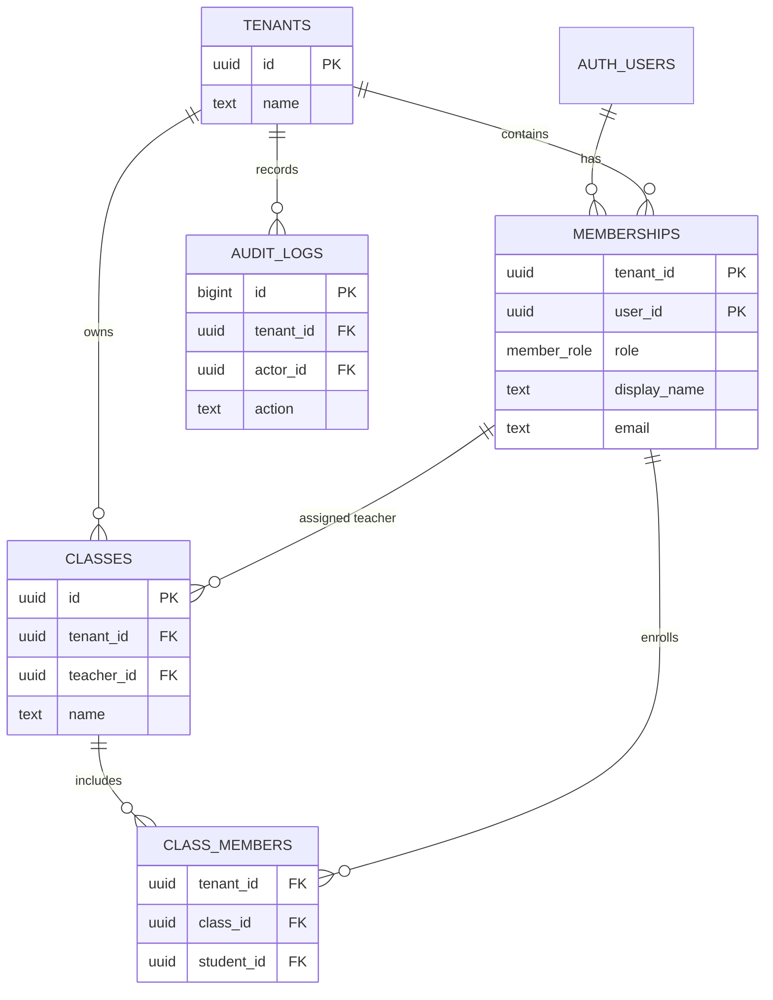

# Days 1–3 foundation contract

## Scope

Day 1–3 establishes one tenant-aware foundation:

1. School Admin, Teacher and Student can authenticate.
2. Each account resolves membership for the selected tenant.
3. School Admin can see seeded classes and membership data on web.
4. Student can see only enrolled classes on mobile.
5. Tenant A cannot read or write Tenant B data.

Out of scope: account invitation UI, assignments, file uploads, AI, community, notifications and dynamic roles.

## Ownership

| Lane | Paths |
|---|---|
| Platform/Data | `supabase/**`, shared contracts |
| Web | `apps/web/**` |
| Mobile | `apps/mobile/**` |
| Reviewer | Cross-tenant/RLS tests and evidence |

## Roles

| Action | School Admin | Teacher | Student |
|---|---:|---:|---:|
| Read tenant profile | Yes | Yes | Yes |
| Read class | Tenant classes | Assigned classes | Enrolled classes |
| Read class members | Tenant classes | Assigned classes | No |
| Create/update class | Yes | No | No |
| Change membership | Yes | No | No |

The server never trusts a client-provided tenant without validating the authenticated membership. Request paths use the user's JWT; service-role is restricted to migrations, seed and offline operations.

## Minimal API contract

```text
POST /api/auth/login
GET  /api/session
GET  /api/classes
GET  /api/classes/:id
```

Day 3 UI may read Supabase directly with the user's JWT while RLS is the source of authorization. A BFF becomes mandatory when write workflows start on Day 4.

## Foundation gate

- Three roles can sign in for each seeded tenant.
- `supabase db reset` reproduces schema and seed.
- Every business table has RLS enabled.
- Cross-tenant reads return zero rows or an authorization error.
- Web renders the class split view at 1440px without overflow.
- Android renders Home/Class at 412×915 without clipped primary content.

## Day 1 scope freeze

### Personas and priorities

| Persona | Primary need | Days 1–3 priority |
|---|---|---|
| School Admin | Enter the correct campus and inspect its people/classes | P0 |
| Teacher | Enter the correct campus and see assigned classes | P0 |
| Student | Enter the correct campus and see enrolled classes | P0 |
| Release Operator | Reproduce schema, seed, tests and builds without application access to privileged credentials | P0 operational |

P0 is limited to authentication, membership resolution, tenant-safe class reads, reproducible seed/migrations, shared contracts and usable web/mobile shells. P1 contains class mutation and the assignment → submission → feedback vertical slice; it is implemented and evidenced separately in [`day-4-7-academic-alpha.md`](day-4-7-academic-alpha.md). P2 contains invitations/import, files, notifications, community and all AI capabilities. P2 remains deferred; AI is OFF.

### Ten-flow disposition

| Original acceptance flow | Sprint 0 disposition |
|---|---|
| 1. School onboarding | Seeded local tenants/accounts only; invite, import and production provisioning deferred |
| 2. Academic end-to-end | P1 after the foundation freeze; text-only implementation recorded in Days 4–7 |
| 3. Cited AI tutor | Deferred; AI OFF |
| 4. Student support | Deferred; AI OFF |
| 5. Camera translation | Deferred |
| 6. Community safety | Deferred |
| 7. Listings | Deferred |
| 8. Profile/portfolio | Deferred |
| 9. Provider outage | Not applicable while AI is OFF; academic surfaces must remain provider-independent |
| 10. Multi-tenant isolation | P0; enforced by database constraints/RLS and tested with Campus A/B |

### Architecture decision record

| Decision | Status | Consequence |
|---|---|---|
| ADR-001: pnpm monorepo with separate web, mobile and shared contracts | Accepted | One lockfile and one CI surface; no additional framework |
| ADR-002: Supabase Auth + PostgreSQL RLS is the authorization source of truth | Accepted | UI hiding never substitutes for server/database authorization |
| ADR-003: Browser/mobile use the public anon key and caller JWT; no service-role key on request paths | Accepted | Privileged credentials are limited to migration, seed and offline operator work |
| ADR-004: Reads may use RLS directly in the foundation; writes move through the BFF from Day 4 | Accepted | Mutation validation, quotas and response contracts stay server-controlled |
| ADR-005: Preserve the supplied logo and derive shared tokens/geometry from it | Accepted | Web/mobile reuse navy, cobalt, red and yellow without redrawing the mark |

### Backlog and acceptance criteria

| Item | Acceptance criteria | State |
|---|---|---|
| Reproducible local foundation | Clean reset creates both tenants, six accounts and expected memberships/classes | Done |
| Tenant isolation | Cross-tenant reads return no rows and cross-tenant writes are rejected for all three roles | Done locally |
| Web/mobile access shells | Correct role/campus/classes render; missing runtime configuration fails closed | Done locally |
| Hosted verification | Immutable SHA passes quality, database, integration and browser jobs | In progress; release evidence must name the green run |
| Staging promotion | Named Supabase project, HTTPS web/BFF, fresh tests and accountable owner | Blocked on approved external credentials |

### Service-account and secret boundary

| Identity/credential | Allowed use | Prohibited use |
|---|---|---|
| Public Supabase anon key | Web/mobile bootstrap protected by RLS | Treating it as authorization or embedding a service-role key |
| Seeded synthetic users | Local automated/manual flows | Real learner data or a school pilot |
| Database owner/local CLI | Migrations, seed, backup/restore smoke in the disposable local project | Browser/mobile runtime and shared-environment reset |
| GitHub Actions token | Read repository contents for CI | Deployment or production mutation in the current workflow |

No additional application service account exists in the Days 1–3 runtime.

### Success metrics

- 6/6 seeded role-and-campus sign-ins resolve the expected membership.
- 100% of business tables have RLS enabled and tenant predicates covered by pgTAP.
- Zero successful cross-tenant reads or writes in the two-tenant test matrix.
- Clean reset, lint, typecheck, web build, Android export and hosted CI are reproducible from the lockfile.
- Critical web content fits 1440 px and the mobile foundation fits 412×915 without clipping its primary action.
- No real-person data, AI provider credential or service-role credential appears in the candidate.

## Day 2 data and security freeze

### Foundation ERD



Composite tenant foreign keys prevent a Teacher or Student membership from being attached to another tenant. The later assignment/submission extension preserves the same composite-key boundary.

### Consent and retention policy v1

- The local fixture is synthetic-only. Authentication is not consent, and no real or under-18 data may enter any environment without named privacy/safeguarding approval.
- Days 1–3 collect only identity metadata needed for membership, tenant/class relationships and audit evidence. AI profiling, advertising, community content, camera media and analytics tracking are absent.
- Local data is disposable and may be removed with the documented reset. A shared staging/production retention schedule, deletion owner, backup retention and subject-request process must be approved before pilot data is provisioned.
- Sessions use Supabase lifecycle controls. Operators end synthetic web sessions by isolating/clearing the browser profile; mobile exposes sign-out.
- Audit records must not contain passwords, tokens or request bodies. Secrets stay in target environment configuration and never in Git.
- The current decision remains NO-GO for real learners, staging promotion or production until the release gates in [`release-candidate.md`](release-candidate.md) are signed.

### Two-tenant security cases

Campus A and Campus B fixtures must cover Admin, Teacher and Student reads; forged tenant/class/member identifiers; cross-tenant class mutation; assignment/submission access after the Day 4 extension; and audit attribution. Database tests are authoritative even when a UI control is hidden.
